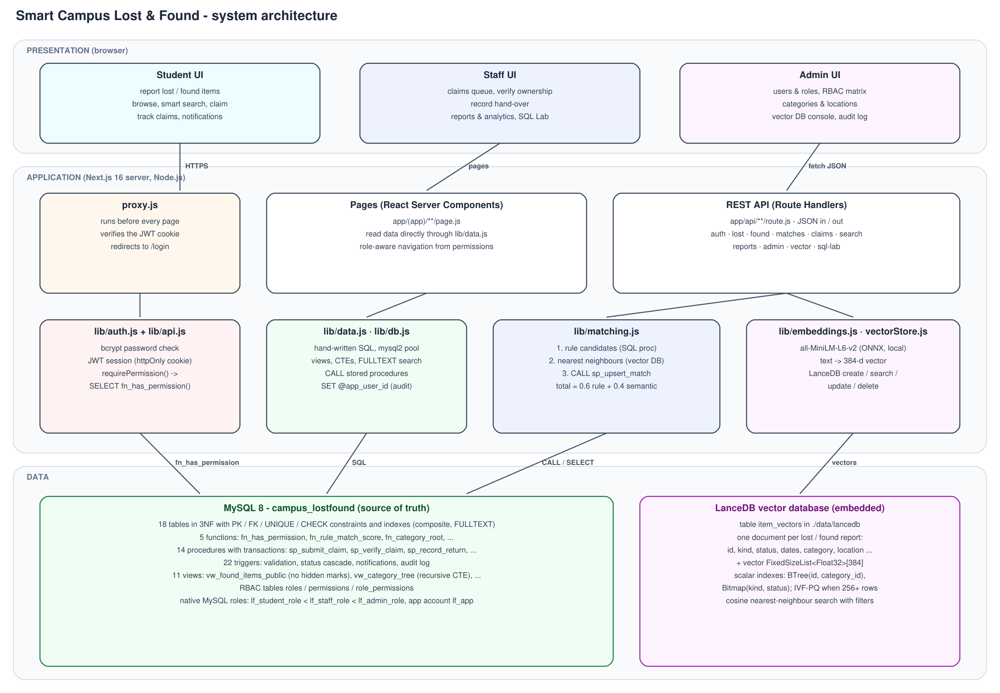

# Smart Campus Lost & Found Management and Matching System

DBMS Mini Project (Experiential Learning Level 3) · PES University · Team 6

- Nagalapuram Sai Mukesh Reddy (PES1UG24AM170)
- Marreddy Rushieswar Reddy (PES1UG24AM158)

A web application where students report lost and found items on campus. The system suggests matches,
students claim items, staff verify ownership and record the hand-over, and admins manage users,
roles and master data.

**Matching is hybrid:**
1. A **MySQL stored function** scores structured attributes: category tree, location, date gap, colour and brand.
2. A **vector database (LanceDB)** scores how similar the descriptions mean.
3. The total is a **generated column**: `0.6 × rule + 0.4 × semantic`.

| Layer | Technology |
|---|---|
| Relational database (source of truth) | **MySQL 8.0**: 18 tables, 5 functions, 14 procedures, 22 triggers, 11 views, native roles |
| Vector database | **LanceDB** (embedded) with `all-MiniLM-L6-v2` sentence embeddings (384-d, runs locally) |
| Web interface + API | **Next.js 16** (React 19, App Router, Route Handlers), `mysql2`, `jose` (JWT), `bcryptjs` |



---

## 1. Quick start

Prerequisites: **Node.js 20.12+** and **MySQL 8.0.16+** running locally. MySQL Workbench is optional.

```bash
npm install
```

```bash
npm run db:setup
```
This asks for your MySQL **root** password. The password is used for this one connection only and is never stored.
The script creates `.env.local`, runs `db/01_schema.sql` … `db/07_security.sql` in order, loads the sample data,
and creates the least-privilege app account `lf_app`.

```bash
npm run vector:sync
```
This builds the vector database from MySQL and computes the semantic match scores. The first run downloads the
embedding model (about 23 MB) into `.cache/`.

```bash
npm run dev
```
Then open http://localhost:3000.

Optional checks:

```bash
npm run db:test
```
Runs 32 automated tests of constraints, triggers, functions, views and procedures (non-destructive).

```bash
npm run vector:demo
```
A stand-alone walk-through of create / read / update / delete on the vector database (good for the viva).

**Without Node (Workbench only):** open and run the files in `db/` in numeric order. Everything works except the
semantic part of matching, which needs the vector database.

### Demo accounts
All seeded accounts use the password `Password@123` (stored only as a bcrypt hash, see `db/06_seed.sql`).
The login page also has one-click demo buttons.

| Role | Email | Notes |
|---|---|---|
| ADMIN | `admin@pes.edu` | users & roles, RBAC matrix, master data, vector DB console, audit log |
| STAFF | `staff@pes.edu`, `security@pes.edu` | claims queue, verification, hand-over, reports, SQL Lab |
| STUDENT | `mukesh@pes.edu`, `rushieswar@pes.edu`, + 15 more | report, search, claim |

MySQL-level demo users (for showing native roles in Workbench): `lf_student_demo` / `Student@2026`,
`lf_staff_demo` / `Staff@2026`.

---

## 2. Rubric map: where each evaluation component lives

| # | Component (marks) | Where |
|---|---|---|
| 1 | ER diagram (2) | [`docs/diagrams/er_diagram.png`](docs/diagrams/er_diagram.png) (Chen notation) · [`docs/DATABASE_DESIGN.md`](docs/DATABASE_DESIGN.md) |
| 2 | Relational schema with keys, relationships, constraints (3) | [`docs/diagrams/relational_schema.png`](docs/diagrams/relational_schema.png) · [`docs/DATABASE_DESIGN.md`](docs/DATABASE_DESIGN.md) (normalisation, FDs) |
| 3 | SQL DDL with constraints (4) | [`db/01_schema.sql`](db/01_schema.sql): PK, FK with ON DELETE rules, UNIQUE, NOT NULL, CHECK (REGEXP), DEFAULT, generated column, indexes, FULLTEXT |
| 4 | NoSQL / Vector database creation (4) | [`lib/vectorStore.js`](lib/vectorStore.js) (Arrow schema, `createEmptyTable`, BTree/Bitmap/IVF-PQ indexes) · [`scripts/sync-vectors.mjs`](scripts/sync-vectors.mjs) · [`docs/VECTOR_DATABASE.md`](docs/VECTOR_DATABASE.md) |
| 5 | Technology justification (1) | [`docs/ARCHITECTURE.md`](docs/ARCHITECTURE.md) section 2 |
| 6 | DML operations (4) | [`db/06_seed.sql`](db/06_seed.sql) · [`db/queries/01_dml_operations.sql`](db/queries/01_dml_operations.sql) · API routes in `app/api/**` |
| 7 | Nested / correlated / recursive queries, joins (4) | [`db/queries/02_joins.sql`](db/queries/02_joins.sql) · [`03_nested_correlated.sql`](db/queries/03_nested_correlated.sql) · [`04_cte_recursive_window.sql`](db/queries/04_cte_recursive_window.sql) |
| 8 | Procedures / functions, triggers, CTE (6) | [`db/02_functions.sql`](db/02_functions.sql) · [`db/03_procedures.sql`](db/03_procedures.sql) · [`db/04_triggers.sql`](db/04_triggers.sql) · [`db/05_views.sql`](db/05_views.sql) · [`db/queries/06_routines_triggers.sql`](db/queries/06_routines_triggers.sql) · [`07_transactions.sql`](db/queries/07_transactions.sql) |
| 9 | NoSQL / Vector feature, Read-Update-Delete (7) | semantic matching ([`lib/matching.js`](lib/matching.js)), Smart search page, Admin → Vector database console (read / update / re-embed / delete), [`scripts/vector-demo.mjs`](scripts/vector-demo.mjs) |
| 10 | Next.js interface (3) | `app/` (22 pages: dashboard, lost/found, smart search, claims, reports, SQL Lab, admin) |
| 11 | Backend / API + DB integration (2) | `app/api/**/route.js` (43 REST endpoints in 31 route files), [`lib/db.js`](lib/db.js), [`docs/ARCHITECTURE.md`](docs/ARCHITECTURE.md) section 5 |
| 12 | Authentication, 2+ roles, RBAC in database (4) | login/register + JWT cookie ([`lib/auth.js`](lib/auth.js), [`proxy.js`](proxy.js)); 3 roles; `roles`/`permissions`/`role_permissions` + `fn_has_permission()` used by API, procedures and triggers; native MySQL roles in [`db/07_security.sql`](db/07_security.sql) |
| 13 | Documentation, Git/GitHub (2) | this README, `docs/`, [`docs/TEAM_AND_GIT.md`](docs/TEAM_AND_GIT.md) |
| 14 | Originality, contribution, viva (4) | [`docs/VIVA_GUIDE.md`](docs/VIVA_GUIDE.md) (demo script, likely questions, live-modification exercises) |

---

## 3. Features

- **Report lost / found items** with category (3-level tree), campus location, date, colour, brand.
  Finders can add *secret identifying marks* that only staff can see.
- **Hybrid matching** when a report is created or edited. Owners of strong matches (score of 55% or more) are notified
  by a trigger.
- **Smart search**: describe the item in your own words. Vector search is shown next to MySQL FULLTEXT results for comparison.
- **Claims workflow**:
  1. The student submits proof (`sp_submit_claim`, with a row lock).
  2. Staff compare it with the secret marks and approve or reject (`sp_verify_claim`). Approving one claim
     auto-rejects competing claims through a trigger cascade.
  3. Staff record the hand-over (`sp_record_return`). High-value items need an ID check.
  4. Triggers close the case: the item becomes RETURNED, the lost report RECOVERED, and both owner and finder are notified.
- **Notifications** and a full **audit log**, both written by triggers. The acting user is recorded through `@app_user_id`.
- **Reports & analytics**: KPIs, monthly trend (recursive CTE), category and building stats, recovery rate,
  finder leaderboard (window functions).
- **SQL Lab**: all 73 annotated queries from `db/queries/` can be run live. DML and trigger demos run inside a
  transaction that is always rolled back.
- **Admin**:
  - change roles (stored procedure keeps the last admin);
  - live RBAC matrix;
  - categories / locations;
  - housekeeping procedures (cursor-based reminders, disposing unclaimed items);
  - vector DB console;
  - audit log.

## 4. Project structure

```
db/                      MySQL scripts, run in order by npm run db:setup
  01_schema.sql          DDL: tables, keys, constraints, indexes
  02_functions.sql       stored functions (RBAC check, match score, category tree walk ...)
  03_procedures.sql      stored procedures with transactions, OUT params, a cursor
  04_triggers.sql        22 triggers (validation, status cascade, notifications, audit)
  05_views.sql           11 views (sanitised per role, recursive CTE, analytics, window functions)
  06_seed.sql            sample data (dates relative to today)
  07_security.sql        MySQL roles, column-level grants, app account
  queries/               annotated query files used by the SQL Lab (DML, joins, nested, CTE, ...)
lib/                     server-side modules (db, auth, data access, matching, embeddings, vector store)
app/                     Next.js App Router: pages under (app)/ and (auth)/, REST API under api/
components/              React components (forms, tables, charts, admin consoles)
scripts/                 setup-db, sync-vectors, test-db, vector-demo
docs/                    architecture, database design, vector DB, viva guide, diagrams
proxy.js                 Next.js 16 proxy: redirects signed-out users to /login
```

## 5. Configuration (`.env.local`)

| Variable | Default | Meaning |
|---|---|---|
| `DB_HOST` / `DB_PORT` / `DB_NAME` | `127.0.0.1` / `3306` / `campus_lostfound` | MySQL server |
| `DB_USER` / `DB_PASSWORD` | `lf_app` / `LfApp@2026` | least-privilege account created by `07_security.sql` |
| `AUTH_SECRET` | random (generated by `db:setup`) | signs the JWT session cookie |
| `LANCEDB_DIR` | `./data/lancedb` | vector database folder |
| `EMBEDDING_MODE` | `transformer` | `hash` uses an offline n-gram embedding instead of the model |

## 6. Troubleshooting

- **`ER_ACCESS_DENIED` for lf_app:** run `npm run db:setup` again. It recreates the account with the password in `.env.local`.
- **The model download fails (offline):** set `EMBEDDING_MODE=hash` and run `npm run vector:sync` again.
- **Port 3000 is busy:** `npm run dev -- -p 3001`.
- **To reset all data:** `npm run db:setup` and then `npm run vector:sync`.
