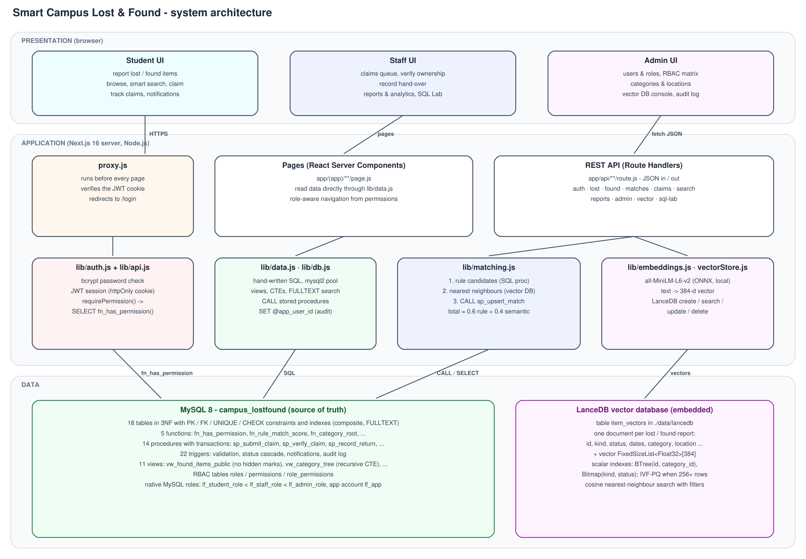
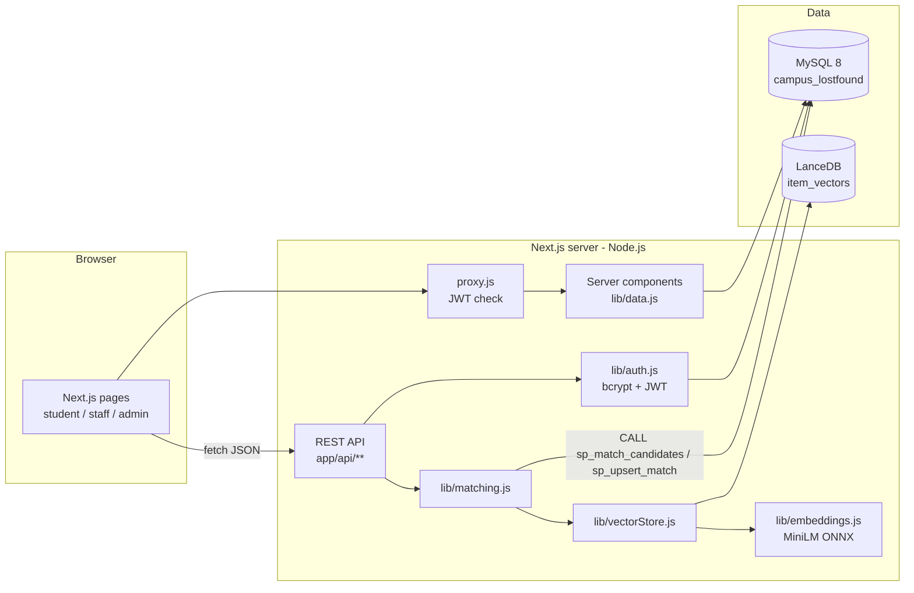

# Architecture



## 1. Overview

The system has three tiers:

| Tier | What runs there |
|---|---|
| **Presentation** | React pages rendered by Next.js. Server components read data directly; client components (forms, buttons) call the REST API with `fetch`. |
| **Application** | Next.js 16 on Node.js. `proxy.js` checks the session cookie before every page. Route handlers in `app/api/**` implement the REST API. Shared modules in `lib/` hold all database access, authentication/RBAC, the matching engine and the vector store. |
| **Data** | **MySQL 8** is the source of truth for every business record. **LanceDB** is an embedded vector database holding one embedding per lost/found report; it is used for semantic matching and natural-language search. |



## 2. Technology justification

| Choice | Why |
|---|---|
| **MySQL 8.0** (relational, source of truth) | Lost/found/claim data is highly structured and relational. Claims reference found items, verifications reference claims, and so on, so foreign keys and transactions are essential. MySQL 8 has everything the course asks for: enforced CHECK constraints (8.0.16+), recursive CTEs, window functions, triggers, stored programs, roles and FULLTEXT indexes. It was already installed on the team's machines and Workbench is used in the labs. |
| **InnoDB** | Row-level locking (`SELECT ... FOR UPDATE`) for concurrent claim verification, ACID transactions and foreign keys. |
| **LanceDB** (vector database) | Matching "black OnePlus with cracked guard" to "lost my mobile, screen protector broken" is a *meaning* problem: keyword search misses it. A vector database stores embeddings and answers nearest-neighbour queries with metadata filters (`kind = 'found' AND status IN (...)`). LanceDB is embedded (no separate server to install), open source, file-based (Lance columnar format) and supports scalar indexes (BTree, Bitmap), ANN indexes (IVF-PQ, HNSW), versioning, update and delete. |
| **all-MiniLM-L6-v2** via `@huggingface/transformers` | A small (23 MB) sentence-embedding model that runs locally on CPU through ONNX. No API key and no cost; the data never leaves the machine. It produces 384-dimension normalised vectors, so cosine similarity is a dot product. An offline hashed n-gram fallback keeps the app working without the model. |
| **Next.js 16 (App Router)** | Required by the rubric. One codebase serves both the UI and the REST API (route handlers). Server components can query MySQL directly, so there is no separate backend server. |
| **mysql2 + hand-written SQL** (no ORM) | The project's focus is SQL. Every query is visible, parameterised (`?` placeholders, which prevents SQL injection) and reuses the database's views, functions and procedures. |
| **JWT in an httpOnly cookie** (`jose`) + **bcrypt** (`bcryptjs`) | Stateless sessions that JavaScript cannot read (XSS-safe), with `SameSite=Lax` (CSRF mitigation). Passwords are stored only as bcrypt hashes with cost 10. |

## 3. Main flows

### 3.1 Report a lost item → hybrid matching
```mermaid
sequenceDiagram
  participant S as Student (browser)
  participant API as POST /api/lost
  participant DB as MySQL
  participant V as LanceDB
  S->>API: title, description, category, location, date
  API->>DB: SELECT fn_has_permission(user, 'REPORT_LOST')
  API->>DB: SET @app_user_id; INSERT INTO lost_items
  Note over DB: BEFORE INSERT trigger validates the date and normalises values<br/>AFTER INSERT trigger writes audit_log
  API->>V: embed(title + description) -> upsert document "lost-N"
  API->>DB: CALL sp_match_candidates_for_lost(N)  (rule scores)
  API->>V: vectorSearch(kind='found', open statuses, date >= lost_date-1)
  loop every candidate
    API->>DB: CALL sp_upsert_match(lost, found, semantic, 0.35)
    Note over DB: total_score = 0.6 rule + 0.4 semantic (generated column)<br/>trigger: if total >= 0.55 then lost -> MATCHED and notify owner
  end
  API-->>S: {lost_id, matches}
```

### 3.2 Claim → verification → hand-over
| Step | API | Database work |
|---|---|---|
| Student claims | `POST /api/claims` | `CALL sp_submit_claim` locks the item (`FOR UPDATE`) and inserts the claim. Triggers set the item to CLAIM_PENDING and notify every user who holds CLAIM_VERIFY. |
| Staff decide | `POST /api/claims/:id/verify` | `CALL sp_verify_claim` checks the permission, locks claim + item, validates the state and inserts the verification. The trigger copies the decision to the claim and auto-rejects competing claims; the claims trigger updates the item and notifies the claimant. |
| Staff hand over | `POST /api/claims/:id/return` | `CALL sp_record_return`. The BEFORE trigger requires an ID check for high-value categories. The AFTER trigger calls `sp_apply_handover`: item → RETURNED, lost report → RECOVERED, matches CONFIRMED/DISMISSED, owner and finder notified. |
| Vector mirror | (same requests) | Status changes are copied to the vector documents (`table.update`). |

## 4. Matching algorithm

```
rule_score (MySQL fn_rule_match_score, 0..1)
  category  0.35 x relation   (same 1.0, parent/child 0.6, siblings 0.3, same root 0.15)
  location  0.25 same spot | 0.15 same building | 0.05 same zone
  date      0.20 <= 1 day | 0.15 <= 3 | 0.10 <= 7 | 0.05 <= 30
            found more than 1 day BEFORE it was lost -> the whole rule score is 0 (it cannot be the same item)
  colour    0.15 same | 0.05 if one side is multicolor/other
  brand     0.05 same brand

semantic_score (LanceDB) = cosine similarity of the two description embeddings, clamped to 0..1
total_score   = 0.6 x rule + 0.4 x semantic        (STORED generated column)
stored        if total >= 0.35       strong match (trigger notifies owner)  if total >= 0.55
```
Candidates are the **union** of the SQL rule candidates and the 15 nearest vector neighbours. This catches
both "same place and same day, but described differently" and "described the same, but filed under a different category".
If the vector database is unavailable, matching falls back to rule scores only.

## 5. REST API

All endpoints return JSON. Mutations require a session cookie, and protected endpoints check
`fn_has_permission()` in MySQL.

| Method & path | Permission | Purpose |
|---|---|---|
| `POST /api/auth/register` | public | student self-registration (`sp_register_student`, transaction) |
| `POST /api/auth/login` · `POST /api/auth/logout` · `GET /api/auth/me` | public / user | session handling |
| `GET /api/meta` | user | categories (tree), locations, buildings, departments, colours |
| `GET /api/lost` · `POST /api/lost` | user · REPORT_LOST | list with filters (`q` FULLTEXT, `category` incl. sub-tree, `building`, `status`, `from`, `to`, `mine`) / create + match |
| `GET/PATCH/DELETE /api/lost/:id` | owner or MATCH_MANAGE | detail with matches / edit (re-embed) / close / reopen / delete |
| `GET /api/found` · `POST /api/found` | user · REPORT_FOUND | public list (no hidden marks) / create + match |
| `GET/PATCH/DELETE /api/found/:id` | user / finder or staff / ITEM_DISPOSE | detail (staff also see claims, matches, hidden marks) / edit / dispose / delete |
| `POST /api/matches/run` · `PATCH /api/matches/:id` | owner or MATCH_MANAGE | re-run matching / dismiss a suggestion |
| `GET /api/claims` · `POST /api/claims` | user · CLAIM_SUBMIT | list (own or queue) / submit (`sp_submit_claim`) |
| `GET /api/claims/:id` | claimant or CLAIM_VERIFY | detail |
| `POST /api/claims/:id/verify` · `/return` · `/withdraw` | CLAIM_VERIFY · RETURN_RECORD · claimant | `sp_verify_claim` · `sp_record_return` · `sp_withdraw_claim` |
| `GET /api/search?q=&kind=` | user | semantic search (vector DB) |
| `GET/POST /api/notifications` | user | list / mark all read |
| `GET /api/reports` | REPORTS_VIEW | analytics |
| `GET/POST /api/sql-lab` | SQL_LAB_VIEW | list / run a predefined query block |
| `PATCH /api/admin/users/:id` | USER_MANAGE | role (`sp_change_user_role`) / activate |
| `GET/POST /api/admin/rbac` | RBAC_MANAGE | grant / revoke a permission |
| `POST /api/admin/categories`, `/locations`, `DELETE .../:id` | MASTER_DATA_MANAGE | master data |
| `POST /api/admin/housekeeping` | ITEM_DISPOSE / MASTER_DATA_MANAGE | `sp_dispose_unclaimed`, `sp_remind_stale_reports` |
| `GET /api/vector` · `POST /api/vector/sync` · `POST /api/vector/search` | VECTOR_DB_MANAGE | stats + documents / rebuild / raw ANN query |
| `PATCH/POST/DELETE /api/vector/:id` | VECTOR_DB_MANAGE | update metadata / re-embed / delete a vector document |

Errors raised by the database are turned into readable messages by `dbErrorMessage()` in `lib/db.js`:
`SIGNAL` messages, CHECK names, duplicate keys and FK violations.

## 6. Security design

- **Authentication**:
  - bcrypt hashes;
  - JWT (HS256, 8 h) in an `httpOnly`, `SameSite=Lax` cookie;
  - `proxy.js` redirects signed-out visitors to `/login`.
- **Authorisation (RBAC in the database)**: role → permissions lives in `roles`, `permissions` and `role_permissions`.
  Every protected route calls `SELECT fn_has_permission(user, code)`. The stored procedures repeat the check, and
  triggers on `verifications` and `item_returns` check it again, so even a direct `INSERT` that bypasses the app is refused.
  Deactivating a user (`is_active = FALSE`) revokes everything on the next request.
- **Least privilege at the MySQL level** (`db/07_security.sql`):
  - the app connects as `lf_app`, which has only DML + EXECUTE (no DROP/ALTER/GRANT);
  - native roles `lf_student_role` ⊂ `lf_staff_role` ⊂ `lf_admin_role`;
  - a column-level grant hides `found_items.hidden_marks` from students.
- **Data minimisation**: students read `vw_found_items_public`, which has no hidden marks and no finder contact details.
- **SQL injection**: every value is passed as a `?` parameter. The SQL Lab runs only predefined blocks from files, and
  "rollback" blocks run in a transaction that is always rolled back.
- **Audit**: triggers record every status change, with the acting user taken from the session variable `@app_user_id`
  that `withUser()` sets on the connection.
