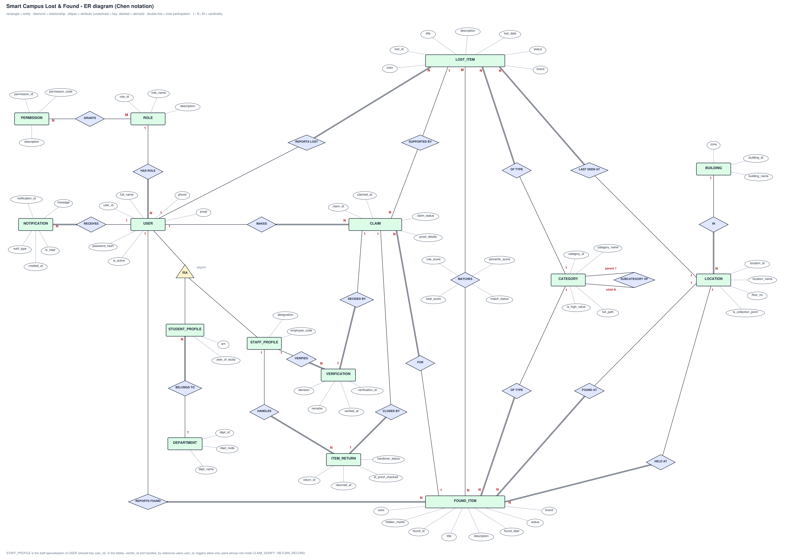
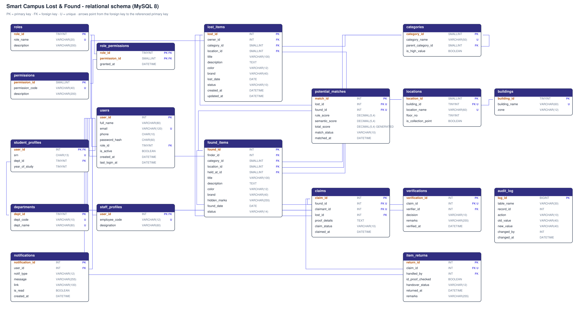
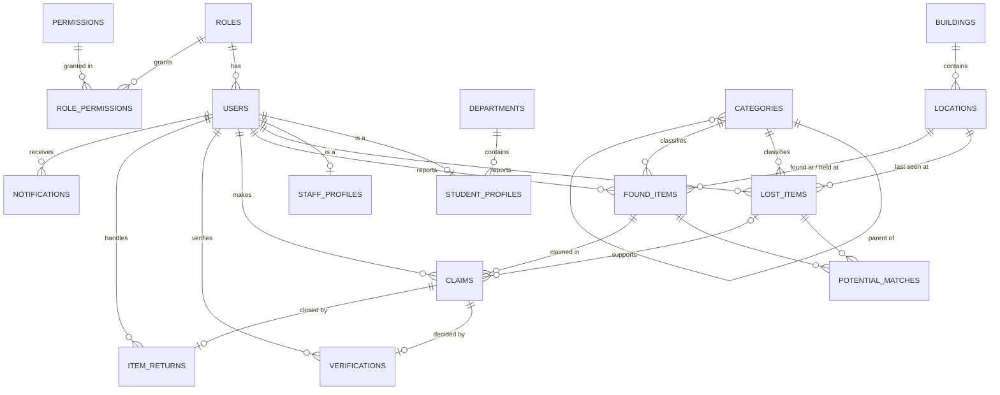

# Database design

## 1. ER diagram



The diagram is in Chen notation:
- rectangles are entities and diamonds are relationships;
- ellipses are attributes (underlined = key, dashed = derived);
- a double line means total participation;
- edge labels give the cardinality.

It is generated from `docs/diagrams/make_diagrams.py`. Edit the coordinates there and run
`python docs/diagrams/make_diagrams.py` to regenerate it.

### Entities
| Entity | Meaning | Key |
|---|---|---|
| USER | anyone who can sign in | user_id |
| STUDENT_PROFILE, STAFF_PROFILE | **specialisations** of USER (disjoint, shared key) | user_id |
| ROLE, PERMISSION | RBAC | role_id, permission_id |
| DEPARTMENT | academic department of a student | dept_id |
| CATEGORY | item category; **recursive** hierarchy (3 levels) | category_id |
| BUILDING, LOCATION | campus places; some locations are collection desks | building_id, location_id |
| LOST_ITEM, FOUND_ITEM | the two kinds of report | lost_id, found_id |
| CLAIM | a user's claim that a found item is theirs | claim_id |
| VERIFICATION | the staff decision on a claim | verification_id |
| ITEM_RETURN | the hand-over of the item | return_id |
| NOTIFICATION | messages created by triggers | notification_id |

### Relationships
| Relationship | Cardinality | Participation / notes |
|---|---|---|
| USER **HAS ROLE** ROLE | N : 1 | every user has exactly one role (total) |
| ROLE **GRANTS** PERMISSION | M : N | resolved by `role_permissions` |
| USER **ISA** STUDENT_PROFILE / STAFF_PROFILE | 1 : 1 | disjoint specialisation |
| STUDENT_PROFILE **BELONGS TO** DEPARTMENT | N : 1 | total |
| USER **REPORTS LOST** LOST_ITEM · USER **REPORTS FOUND** FOUND_ITEM | 1 : N | every report has a reporter (total) |
| LOST_ITEM **MATCHES** FOUND_ITEM | M : N | relationship attributes rule_score, semantic_score, derived total_score, match_status |
| LOST_ITEM / FOUND_ITEM **OF TYPE** CATEGORY | N : 1 | total |
| CATEGORY **SUBCATEGORY OF** CATEGORY | 1 : N | recursive (parent / child roles) |
| LOST_ITEM **LAST SEEN AT** · FOUND_ITEM **FOUND AT** / **HELD AT** LOCATION | N : 1 | FOUND_ITEM has two different relationships with LOCATION |
| LOCATION **IN** BUILDING | N : 1 | total |
| USER **MAKES** CLAIM · CLAIM **FOR** FOUND_ITEM | 1 : N each | a student can claim an item only once |
| CLAIM **SUPPORTED BY** LOST_ITEM | N : 1 | optional (partial) |
| CLAIM **DECIDED BY** VERIFICATION · CLAIM **CLOSED BY** ITEM_RETURN | 1 : 1 | |
| STAFF **VERIFIES** VERIFICATION · STAFF **HANDLES** ITEM_RETURN | 1 : N | only roles with CLAIM_VERIFY / RETURN_RECORD (enforced by triggers) |
| USER **RECEIVES** NOTIFICATION | 1 : N | |

## 2. Relational schema



Underlined = primary key, *italic* = foreign key.

```
roles(role_id, role_name UNIQUE, description)
permissions(permission_id, permission_code UNIQUE, description)
role_permissions(role_id*, permission_id*, granted_at)                        PK(role_id, permission_id)
departments(dept_id, dept_code UNIQUE, dept_name UNIQUE)
users(user_id, full_name, email UNIQUE, phone, password_hash, role_id*, is_active, created_at, last_login_at)
student_profiles(user_id* PK, srn UNIQUE, dept_id*, year_of_study)
staff_profiles(user_id* PK, employee_code UNIQUE, designation)
categories(category_id, category_name UNIQUE, parent_category_id* -> categories, is_high_value)
buildings(building_id, building_name UNIQUE, zone)
locations(location_id, building_id*, location_name, floor_no, is_collection_point)   UNIQUE(building_id, location_name)
lost_items(lost_id, owner_id* -> users, category_id*, location_id*, title, description, color, brand, lost_date, status, created_at, updated_at)
found_items(found_id, finder_id* -> users, category_id*, location_id*, held_at_id* -> locations, title, description, color, brand,
            hidden_marks, found_date, status, created_at, updated_at)
potential_matches(match_id, lost_id*, found_id*, rule_score, semantic_score, total_score GENERATED, match_status, matched_at)
            UNIQUE(lost_id, found_id)
claims(claim_id, found_id*, claimant_id* -> users, lost_id* (nullable), proof_details, claim_status, claimed_at)
            UNIQUE(found_id, claimant_id)
verifications(verification_id, claim_id* UNIQUE, verifier_id* -> users, decision, remarks, verified_at)
item_returns(return_id, claim_id* UNIQUE, handled_by* -> users, id_proof_checked, handover_status, returned_at, remarks)
notifications(notification_id, user_id*, notif_type, message, link, is_read, created_at)
audit_log(log_id, table_name, record_id, action, old_value, new_value, changed_by, changed_at)
```

### ER → relational mapping decisions
- **M:N relationships** become their own tables: `role_permissions`, and `potential_matches`, which also stores the
  relationship's attributes.
- **1:N relationships** become a foreign key on the N side, e.g. `lost_items.owner_id`.
- **1:1 relationships** (claim → verification, claim → return) become a foreign key with a `UNIQUE` constraint
  on the dependent side.
- **Specialisation** uses one table per subclass that shares the superclass key (`student_profiles.user_id` is
  both PK and FK). Common attributes stay in `users` and there are no NULL-heavy columns.
- **Recursive relationship**: `categories.parent_category_id` references `categories`.
- **Multiple relationships to the same entity**: `found_items.location_id` (found at) and `held_at_id` (held at)
  both reference `locations`.
- **Derived attributes** are not stored. `total_score` is a `STORED GENERATED` column, so it can never disagree with its
  inputs, and `days_since_lost` / `full_path` are computed in views.

## 3. Functional dependencies and normalisation

Every table has a single-column surrogate key or a composite key, and every non-key attribute depends on
**the key, the whole key and nothing but the key**.

| Table | Main FDs | Notes |
|---|---|---|
| users | user_id → full_name, email, phone, password_hash, role_id, ...; email → user_id | `email` is a candidate key. Role details are *not* repeated (role_id → role_name lives in `roles`). |
| student_profiles | user_id → srn, dept_id, year_of_study; srn → user_id | department name is in `departments` (avoids the transitive FD user → dept_id → dept_name) |
| locations | location_id → building_id, location_name, floor_no, ...; (building_id, location_name) → location_id | building name/zone are in `buildings`, not repeated per location (3NF) |
| lost_items / found_items | id → all other columns | category and location are stored only as ids |
| potential_matches | match_id → ...; (lost_id, found_id) → match_id, scores, status | both keys are candidate keys; total_score is computed, not stored data |
| claims | claim_id → found_id, claimant_id, lost_id, ...; (found_id, claimant_id) → claim_id | |
| item_returns | return_id → claim_id, handled_by, ...; claim_id → return_id | **found_id and claimant are deliberately not stored**: they are determined by claim_id (claim_id → found_id, claimant_id), and storing them would create redundancy and update anomalies |

- **1NF**: all attributes are atomic (no lists or comma-separated values; permissions are rows, not a CSV column).
- **2NF**: tables with composite keys (`role_permissions`) have no partial dependencies. `granted_at` depends on the whole pair.
- **3NF / BCNF**: there are no transitive dependencies. The determinant of every non-trivial FD is a candidate key
  (e.g. dept_name moved to `departments`, building data moved to `buildings`).

The only intentional extra is `audit_log`, an append-only history that has no FK to users, so history survives user deletion.

## 4. Constraints

| Kind | Examples |
|---|---|
| PRIMARY KEY | every table; composite `role_permissions(role_id, permission_id)`; shared key in the profile tables |
| FOREIGN KEY | 25 references, with `ON DELETE CASCADE` (a user's lost reports, matches of a deleted report), `RESTRICT` (categories/locations in use, finder of a found item, returns) and `SET NULL` (`claims.lost_id`) |
| UNIQUE | email, srn, employee_code, role/permission codes, (building_id, location_name), (lost_id, found_id), (found_id, claimant_id), verifications.claim_id, item_returns.claim_id |
| NOT NULL / DEFAULT | all required columns; defaults for status, timestamps, role_id = STUDENT |
| CHECK | `REGEXP_LIKE` on email, phone (Indian mobile), SRN (`PES1UG24AM170`); enumerated status/colour/zone/decision values; `year_of_study BETWEEN 1 AND 4`; score ranges 0..1; minimum lengths of title/description/proof |
| Triggers (rules a CHECK cannot express) | no future dates; found items must be held at a collection point; a finder cannot claim their own item; the linked lost report must belong to the claimant; high-value items need an ID check; closed items cannot change status; only permitted users can verify or hand over |

## 5. Stored programs

### Functions (`db/02_functions.sql`)
| Function | Purpose |
|---|---|
| `fn_has_permission(user, code)` | RBAC check: active user whose role holds the permission |
| `fn_category_root(category)` | WHILE loop up the hierarchy to the top-level category |
| `fn_category_relation_score(a, b)` | 1 / 0.6 / 0.3 / 0.15 / 0 depending on how the categories are related |
| `fn_rule_match_score(lost, found)` | the rule-based part of matching (see ARCHITECTURE.md §4) |
| `fn_recovery_rate(category)` | % of found items returned in a category sub-tree (recursive CTE inside a function) |

### Procedures (`db/03_procedures.sql`)
| Procedure | Concepts |
|---|---|
| `sp_register_student` | transaction across two tables, OUT parameter, EXIT HANDLER → ROLLBACK + RESIGNAL |
| `sp_submit_claim`, `sp_withdraw_claim` | transaction, `SELECT ... FOR UPDATE` row lock, SIGNAL for business errors |
| `sp_verify_claim` | permission check, locks claim + item, state validation; triggers do the cascade |
| `sp_record_return`, `sp_apply_handover` | hand-over; the second one is called from triggers |
| `sp_match_candidates_for_lost/found` | result-set procedures used by the matching engine |
| `sp_upsert_match`, `sp_refresh_all_rule_matches` | upsert logic; set-based `INSERT ... SELECT ... ON DUPLICATE KEY UPDATE` via a temporary table |
| `sp_flag_strong_match` | called by the potential_matches triggers |
| `sp_change_user_role` | RBAC admin; refuses to remove the last admin |
| `sp_dispose_unclaimed` | bulk UPDATE in a transaction, `ROW_COUNT()` into an OUT parameter |
| `sp_remind_stale_reports` | **cursor** with a `CONTINUE HANDLER FOR NOT FOUND` loop |

### Triggers (`db/04_triggers.sql`, 22 in total)
- **BEFORE INSERT/UPDATE** on users, student_profiles, lost_items, found_items, claims, verifications, item_returns:
  validation (`SIGNAL SQLSTATE '45000'`) and normalisation (trim, lower-case).
- **AFTER INSERT/UPDATE/DELETE** on lost_items and found_items: audit log.
- **potential_matches**: strong match → lost report MATCHED + notification.
- **claims**: item status CLAIM_PENDING / CLAIM_APPROVED / back to AVAILABLE, plus notifications. MySQL does not allow a
  trigger to modify its own table, so auto-rejecting competing claims is done from the `verifications` trigger instead.
- **verifications**: copy the decision to the claim and reject the other pending claims.
- **item_returns**: close the case (`CALL sp_apply_handover`).

### Views (`db/05_views.sql`)
| View | Purpose |
|---|---|
| `vw_category_tree` | **recursive CTE**: depth, full path, root id |
| `vw_locations` | location + building + zone |
| `vw_lost_items_detail` | lost reports joined with every lookup + best match score (correlated sub-query) |
| `vw_found_items_public` | **student view: no hidden_marks, no finder contact** |
| `vw_found_items_staff` | everything + claim counts |
| `vw_claims_detail` | claims with item, claimant, verification and return (LEFT JOINs) |
| `vw_match_suggestions` | matches ranked per lost / found item with `ROW_NUMBER() OVER (PARTITION BY ...)` |
| `vw_user_permissions` | effective permissions per user |
| `vw_category_stats`, `vw_location_hotspots`, `vw_dashboard_kpis` | analytics (CTEs, GROUP BY, COUNT DISTINCT, scalar sub-queries) |

## 6. Indexes

| Index | Used by |
|---|---|
| `idx_lost_category_status`, `idx_found_category_status` (composite) | browsing by category + status, matching candidates |
| `idx_lost_location`, `idx_found_location`, `idx_*_date`, `idx_found_status_date` | location / date filters, the matching date window, ageing reports |
| `ftx_lost_text`, `ftx_found_text` (**FULLTEXT**) | keyword search: `MATCH(title, description) AGAINST (... IN BOOLEAN MODE)` |
| `idx_match_score`, `idx_match_found` | ranking suggestions, matches per found item |
| `idx_claim_status`, `idx_claim_claimant`, `idx_notification_user`, `idx_audit_*` | queues, "my claims", unread notifications, audit filters |

`db/queries/08_indexes_views_security.sql` shows `EXPLAIN` / `EXPLAIN ANALYZE` plans that use these indexes, and the
full scan that `LIKE '%...%'` causes instead.

## 7. Mermaid version (renders on GitHub)


